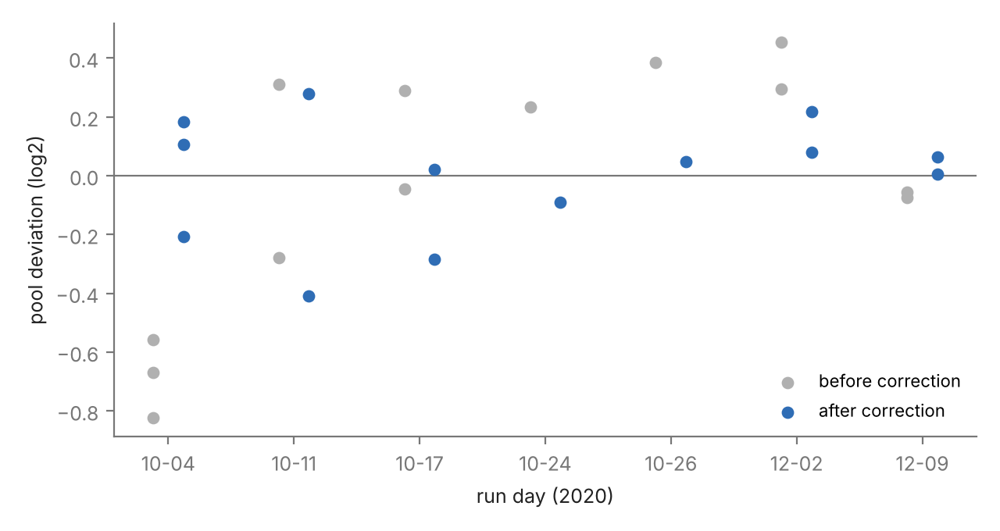
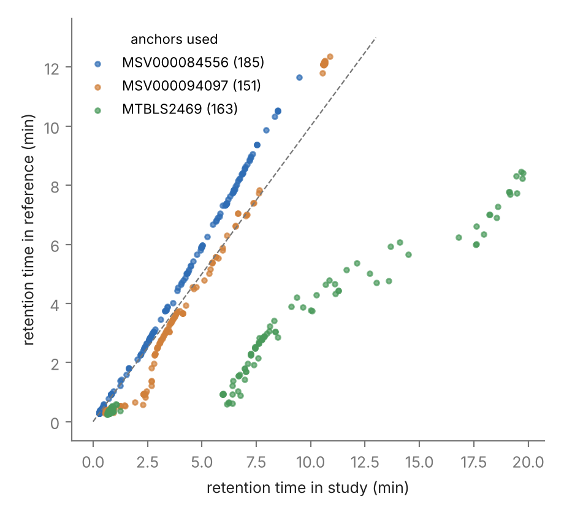

# What breaks when you combine public metabolomics data?

Labs around the world measure small molecules in people's blood, called metabolites, to study disease, diet, exercise, etc, and many of them publish their raw data online. If you could combine those studies, you'd have many more people than any one study has. I wanted to see if that actually works. If you train a model on one study, does it still work on another study's data?

To find out, I took four public human blood metabolomics studies (127 people) and ran them all through the same pipeline with the same settings.

Most of what I learned was about what goes wrong first. In one study, the day a sample was run explained as much of the signal as disease severity did. In the study I trained on, sex and diagnosis were tangled together. One of the three injections of each sample turned out to be a different kind of run, and there were saliva and stool samples mixed into a blood study. After all of that, only 88 of the 7,602 features I could reliably detect in the main study showed up in all four studies.

I did a small test of whether a model transfers, and the results look promising but the test is too small to say for sure. A sex classifier that scores an AUC of 0.72 in its own study scores 0.68 on another study's plasma, 0.81 once I standardize each study separately, and 0.58 on serum from the same people. That test set is only 20 people, so the confidence intervals overlap.

I also found that the method details you need to combine more studies are often wrong. In a follow-up on 45 studies, I had an LLM pull those details out of each paper. It copied them almost exactly as written, but in about 1 in 4 studies the paper contradicts its own raw data files. A better LLM wouldn't fix that. Checking against the raw data does.

## The problem

There are hundreds of human blood metabolomics studies in public repositories, but almost every model built on them is trained and tested within a single study. Every study uses a different instrument, chromatography method, scan range, sample prep and lab, so the same molecule shows up at a different time and a different intensity in each one. Pooling studies could give you much bigger cohorts than any one lab can collect. But right now nobody knows how much of a model's accuracy comes from the biology and how much comes from the study the data came from.

In ML terms this is a distribution shift problem, the same one you run into any time a model sees data from a new source. I asked a small version of the question: **does a model trained on one public study still work on another, and does harmonizing the data help?**

## What I built

I built one pipeline that takes each study from the raw public files to a cleaned-up feature table, using the same settings for every study.

It downloads the data straight from the repositories (about 40 GB total, and it can pick up where it left off) and converts Thermo .raw files to mzML for the MetaboLights study. Each study gets a sample sheet that records the person, visit, sample type, pooled QC, batch, and whether a run is included. The rules for reading that information out of the file names are all in one place. Features are detected with OpenMS at 5 ppm with a fixed noise cutoff, linked across runs, kept if they show up in at least 80% of runs, and summarized in a QC report. When a study's pooled QC samples were run across several days, a correction step removes each day's offset.

| Study | Repository | People | Runs used | Sample type | Clinical label |
| --- | --- | --- | --- | --- | --- |
| MSV000084556 | MassIVE | 20 | 60 | plasma | rheumatoid arthritis, 3 visits |
| MSV000085256 | MassIVE | 78 | 78 | plasma | MCI vs normal |
| MSV000094097 | MassIVE | 21 | 83 + 17 pools | plasma and serum | osteoarthritis, 2 visits |
| MTBLS2469 | MetaboLights | 8 | 22 + 28 pools | plasma | COVID severity |

None of the four studies look at the same disease, so the only labels they all have are sex and age. MSV000085256 is the biggest, so I used it as the reference. Every other study gets matched to it, and it's the study I train models on.

## What broke, and how I caught it

This is where most of my time went. Any of these problems could have quietly messed up a result, and I caught each one by checking the data directly, not because a final number looked strange.

### Retention-time alignment made things worse

The runs in MSV000084556 only drift by less than 2 seconds, but the feature tables came out worse after alignment than before. Alignment had distorted 8 runs, so I turned it off by default.

### The wrong sample types

MSV000094097 includes pooled saliva and stool samples. They took over the PCA (the first two components separated sample types, not people) and threw off the 80% detection filter, so I limited the sample sheets to blood only. Even within blood, the difference between plasma and serum was bigger than the differences between people. The first component put plasma at -16 and serum at +16, so I score them separately.

### One injection was a different experiment

Every sample in MTBLS2469 was injected three times. Injection 2 had 25% fewer MS1 scans and matched the other injections less well (r of 0.68 vs 0.82, in all 50 samples). When I converted the files with every MS level included, I saw why. It had 3,424 MS2 scans, so it was the fragmentation run. I only use injection 3.

### Run day was tangled up with disease severity

In MTBLS2469, the pooled QC samples varied by a median CV of 64% from one run day to the next. Run day explained 99% of the first principal component, and severity explained 94%. A model could learn either one and you wouldn't be able to tell the difference. The correction step shifts every run by its day's offset.

*13 held-out pools, with offsets fitted on the other 15. Data: `processed/figures/batch_drift_MTBLS2469.tsv`.*

I fit the correction on half of each day's pooled samples and tested it on the other half, so it's never graded on the samples it was fit to. On those held-out samples, the CV drops from 64% to 47%. There's still scatter within each day, because the correction only removes the day-to-day offset, not the noise between individual runs.

### One noise cutoff means different things on different instruments

MTBLS2469 gives about 50,000 features per run, compared to 10,000 to 20,000 in the other studies. I kept the same cutoff anyway so every study is treated the same way, and I count it as a limitation.

### Sex and diagnosis are tangled in the training study

In MSV000085256, 14 of the 19 women have MCI, and diagnosis alone predicts sex with an AUC of 0.72. That means a sex classifier could score well just by learning diagnosis. When I checked inside each diagnosis group, the sex signal was still there (0.69 within MCI and 0.68 within normal), so the model isn't only picking up diagnosis.

### The metadata is sometimes just wrong

One repository labels its healthy controls as "Alzheimer's disease". This is what got me interested in the follow-up below.

Looking back at all of these, there was always a shortcut a model could have learned instead of the biology, whether it was run day, sample type, or diagnosis.

## Matching features across studies

A model trained on one study can only use features you can find again in the other study. Of the 7,602 features I reliably detect in the reference study, only 88 show up in all four studies, and 564 show up in at least two.

All four studies use reverse-phase chromatography, so compounds come off the column in the same order, but on different time scales, anywhere from about 5 to 20 minutes. To line them up, I map each study's retention times onto the reference using a fit that keeps the order the same, built from m/z matches that are high-intensity and unambiguous. The match tolerance comes from the fit's cross-validated error. I held 14 known compounds out of the fit to use as an independent check.

*Only the anchors used in the fit are shown. Data: `processed/crossstudy/rt_map_*.tsv`.*

| Study vs reference | Features matched | Known compounds matched |
| --- | --- | --- |
| MSV000084556 | 1,309 (50%) | 5 of 5 |
| MSV000094097 | 541 (19%) | 4 of 6 |
| MTBLS2469 | 1,058 (17%) | 5 of 10 (4 on the wrong peak, 1 missed) |

MSV000084556 and the reference probably come from the same lab using the same method, which would explain why they overlap so much more. Different labs on similar instruments only share a small fraction of their features. MTBLS2469 uses a longer gradient, and its first 7 minutes get squeezed onto the reference's first 2. That's where its anchors are the most scattered and where its known compounds end up on the wrong peak.

## A pilot: does a model still work in a new study?

Sex and age are the only labels all four studies share. I trained models on MSV000085256 (76 people with known sex), using only the features that were matched in each test study, and scored each person once. MSV000084556 only has 2 men and MTBLS2469 is all men, so neither can test sex. That leaves MSV000094097, where the same people gave both plasma and serum (20 people in the test set).

| Sex classifier, trained on MSV000085256 | AUC [95% CI] |
| --- | --- |
| Within its own study, all features | 0.72 [0.56-0.86] |
| Within its own study, the 541 features shared with MSV000094097 | 0.71 [0.56-0.85] |
| MSV000094097 plasma, no harmonization | 0.68 [0.42-0.91] |
| MSV000094097 plasma, per-study z-scoring | 0.81 [0.60-0.98] |
| MSV000094097 serum, no harmonization | 0.68 [0.43-0.93] |
| MSV000094097 serum, per-study z-scoring | 0.58 [0.31-0.86] |

*Each person scored once, 2,000 bootstrap resamples. Full output: `processed/crossstudy/ml_report.txt`.*

The sex classifier carries over to a new study's plasma, and simple per-study standardization helps. Switching to serum, even from the same people, breaks it. Within its own study, the model gets an AUC of 0.72 with all features and 0.71 with just the 541 features it shares with MSV000094097, so limiting it to shared features doesn't cost much. On MSV000094097 plasma it scores 0.68 as is and 0.81 after z-scoring each study separately. On serum it drops to 0.58.

I'd be careful with two things here. The improvement on plasma looks promising, but with only 20 people the intervals overlap, so I can't call it proven. And because sex and diagnosis are tangled in the training study, I checked whether the model was just learning diagnosis. It still separates sex within MCI (0.69) and within normal (0.68). Age didn't work at all. No model did better than just guessing the average age of the training set, even within one study.

## Follow-up: can an LLM fill in the missing metadata?

To combine more studies, you need each one's method details (ion mode, scan range, column, sample type, groups), and those are buried in free text that's often vague or wrong. So I tested whether an LLM can pull them out, and I checked its answers against something other than the text itself, which was the raw data files.

Overall, the LLM does as well as the text lets it. For the details I could check against a raw file, Opus 5.5 never misread a value or took it from the wrong method. But in about 1 in 4 studies the paper contradicts its own raw data, so even a perfect extractor would copy those mistakes. Checking against the raw files is what catches them.

### Setup

I used 45 public LC-MS blood studies that have an open-access paper. For 39 MetaboLights studies, I measured the true values from one raw file (ion mode, scan window, run length, instrument). For 6 Metabolomics Workbench studies, I scored against the repository's structured fields. Two models, Opus 5.5 and Haiku 5.5, each read three texts per study (the methods section, the full paper, and the repository description) and returned 10 fields as structured JSON, with a word-for-word quote backing up each answer. A script checks every quote against the input text, and I went through every wrong answer (157 of them) by hand and labelled what caused it. The full design is in [scripts/llm_eval/SPEC.md](scripts/llm_eval/SPEC.md).

### Most wrong answers came from the text

In 10 of the 39 studies, the text states at least one value that the study's own raw file contradicts. Some papers name a SCIEX QTRAP, an Agilent Q-TOF or a Waters QTOF for data that was actually recorded on a Thermo Q Exactive, or give a scan range of 50-1500 when the real window was 70-1050. In one study, the repository is wrong and the paper is right. Metabolon uses a stock sentence, "the scan range varied slightly between methods but covered 70-1000 m/z", that's wrong for its negative-mode method, which records 80-1000, and both models copy it in every one of those studies.

### The models' own mistakes were rare

On the details I checked against raw files, Haiku made 7 mistakes, and all of them were taking a value from the wrong method, like reporting "both" ion modes for a single-mode file, or the positive-mode gradient for a negative-mode file. Opus made none. When a paper describes two methods that could both match the file, both models pick one instead of saying "not stated" (7 times for Opus and 8 for Haiku on the details that can only be checked against text). Quotes that weren't actually in the text were rare too, 9 of 981 for Opus and 12 of 1,138 for Haiku. Most of those were ion mode read from "NEG" in a file name.

### Details a raw file can't check

For these, I built an answer key from the repositories' structured submitter fields (assay and sample tables the models never saw), and I checked by hand the cases where the paper and the repository disagree. Accuracy was 98% for Opus and 94% for Haiku on chromatography, 94% and 91% on column chemistry, and 93% and 91% on sample type. Here the key and the paper disagree too. In 5 studies, the paper says plasma while the sample table says serum. For the groups each study compares, I wrote reference answers from the sample groups and the paper, and 133 of 135 Opus answers and 127 of 135 Haiku answers were complete. The one wrong answer was Opus guessing at groups the text never defines, which I count as worse than saying "not stated". A second person, who didn't see my grades, agreed with me on 17 of 20 answers.

Accuracy was about the same no matter which text the model read (75-84%), and both models did far better than just always guessing the most common value (13-55% per field). The whole run cost about $13, and Haiku costs about 1/40 as much as Opus for nearly the same accuracy.

## Limitations

The biggest limitation is size. There are 127 people total and only 20 in the key test set, so every cross-study number has a wide interval. The four studies don't share a disease, so I could only test sex and age, and sex in only one test study. Everything is positive ion mode with one noise cutoff across different instruments, and the MTBLS2469 correction borrows offsets for 4 samples that were run on days without pooled QCs.

For the LLM evaluation, I only hand-checked the wrong answers, so some right answers could be right by luck. The Workbench prompts didn't name a raw file, so I left out their ion-mode answers. And I wrote the group reference answers myself, and the blind second rating only covered 20 answers from 15 studies.

## Next steps

- Add more of the 136 candidate studies. MTBLS2542 is next (320 runs, 51 GB).
- Try better harmonization than z-scoring, for example matching on reference compounds or pooled QCs.
- Use the LLM extractor to fill in method details across all the candidate studies, with raw-file checks to flag where the text is wrong.

## Code and data

- Code, sample sheets and QC reports: this repo
- LLM eval: the scripts are in `scripts/llm_eval/`. The answer key and per-study results aren't public yet. I'll add them once the answer key is fully verified.
- Data: MassIVE MSV000084556, MSV000085256, MSV000094097; MetaboLights MTBLS2469
- Original papers for each study: DOIs in `processed/paper_survey.tsv`
